<div align="center">
  
  <h1>Pump</h1>
  <p>Da primeira série à próxima ficha. Registre o treino, organize as refeições e veja sua evolução ao longo das semanas.</p>
  <p><a href="https://yagoramires.github.io/pump/"><strong>Abrir o Pump</strong></a> · <a href="#primeiros-passos">Primeiros passos</a> · <a href="#rodar-localmente">Rodar localmente</a></p>
  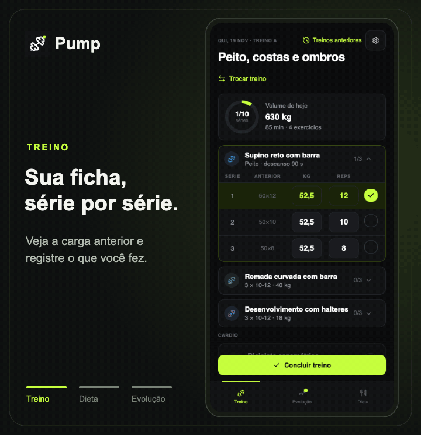
</div>

O Pump é um app instalável que guarda os registros no próprio aparelho. As telas abaixo usam uma ficha de exemplo e imagens de progresso fictícias.

## Primeiros passos

No iPhone, abra o Pump no Safari e toque em **Compartilhar → Adicionar à Tela de Início**. Na primeira abertura, preencha o perfil e escolha seus objetivos. Em **Dia zero**, registre o peso e, se quiser, medidas e fotos para comparar depois.

Escolha uma ficha pronta, monte a sua ou importe um plano. A montagem do treino e a da dieta podem ser puladas e retomadas em Configurações.

<details>
<summary>Ver objetivos, Dia zero e escolha de treino</summary>

| Objetivos | Dia zero | Seu treino |
| :---: | :---: | :---: |
| 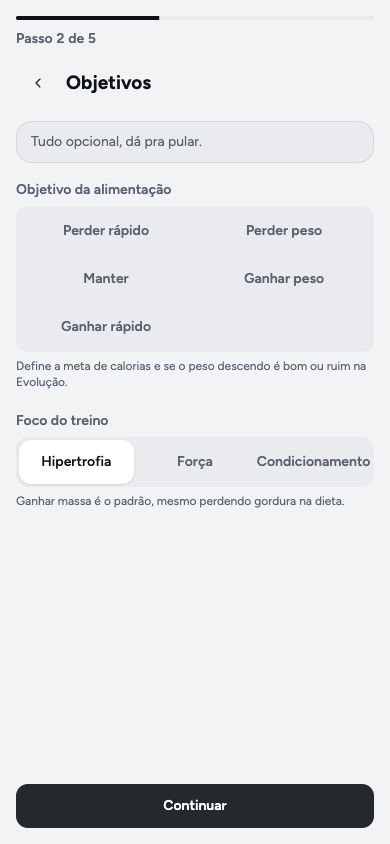 | 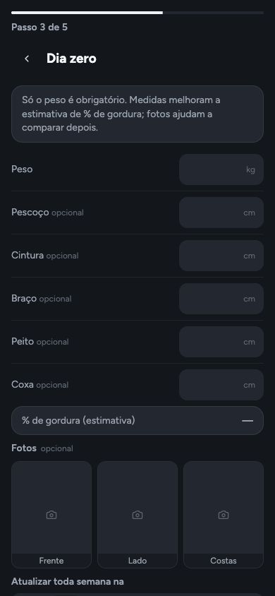 | 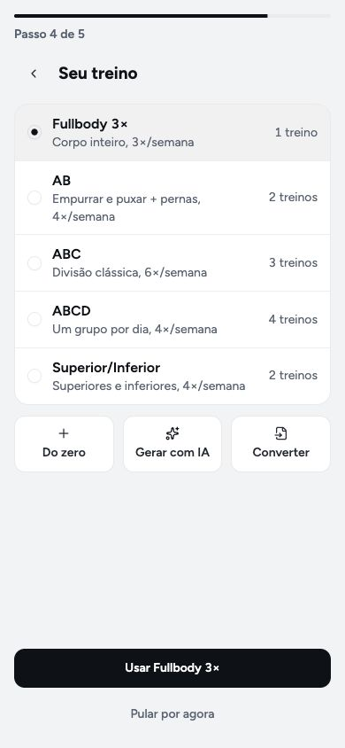 |

</details>

## Treino

Abra a ficha do dia para ver os exercícios e os músculos que vão trabalhar. Durante o treino, cada linha corresponde a uma série. Ajuste a carga e as repetições, marque a série e acompanhe o descanso. Ao concluir, registre como foi o esforço e veja o resumo da sessão.

| Antes de começar | Entre as séries | Treino concluído |
| :---: | :---: | :---: |
| 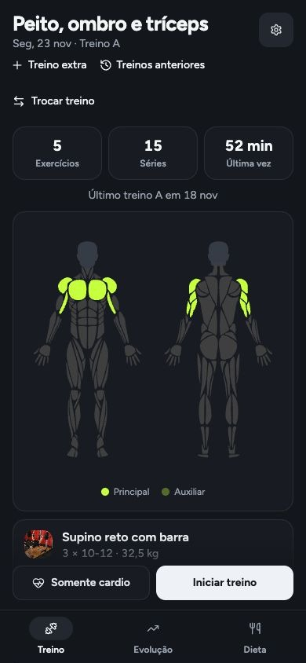 | 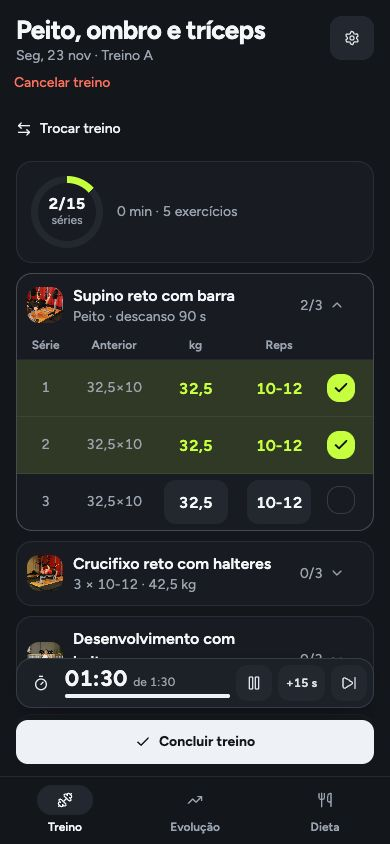 | 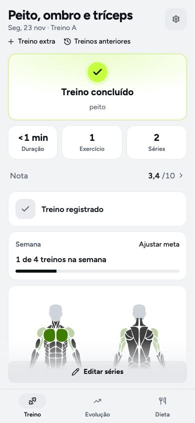 |

- **Ajustar a ficha.** Em **Configurações → Editar plano**, toque na miniatura para ver a execução ou no nome do exercício para editar séries, repetições, carga e descanso. Uma prescrição como **12-10-8** preenche as três séries em ordem.
- **Mudar o dia.** Use **Trocar treino** para escolher outra ficha ou marque um dia de descanso. **Treinos anteriores** reúne as sessões concluídas.
- **Controlar o intervalo.** Quando há descanso programado, marcar uma série inicia o cronômetro. Dá para pausar, acrescentar 15 segundos ou pular o intervalo.
- **Compartilhar a sessão.** No resumo do treino concluído, escolha **Post 4:5** ou **Stories 9:16**. Selecione os dados e use uma foto sua, um fundo sólido ou um fundo transparente. Arraste a foto na prévia, ajuste o **Zoom da foto** e toque em **Centralizar** para voltar ao meio.

## Evolução

Abra um exercício para ver como a carga variou de uma sessão para outra. Para acompanhar mudanças no corpo, registre medidas e fotos ao longo das semanas e escolha duas datas para comparar lado a lado.

| Carga por exercício | Comparação por data | Conquistas |
| :---: | :---: | :---: |
| 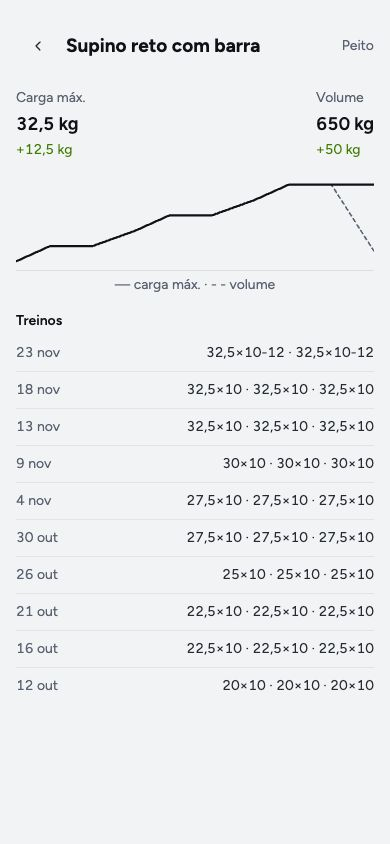 | 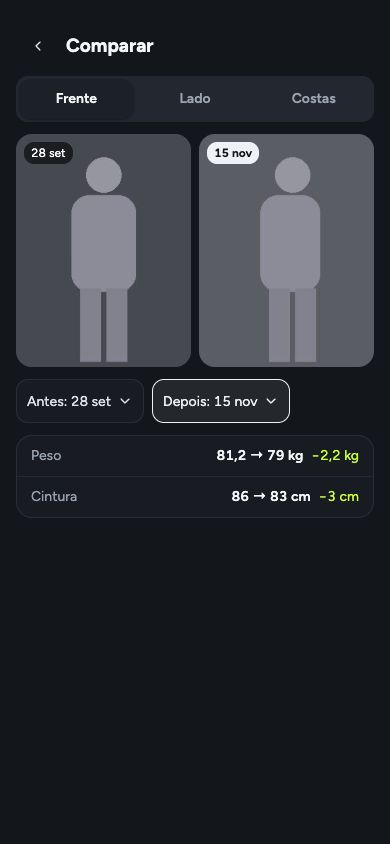 | 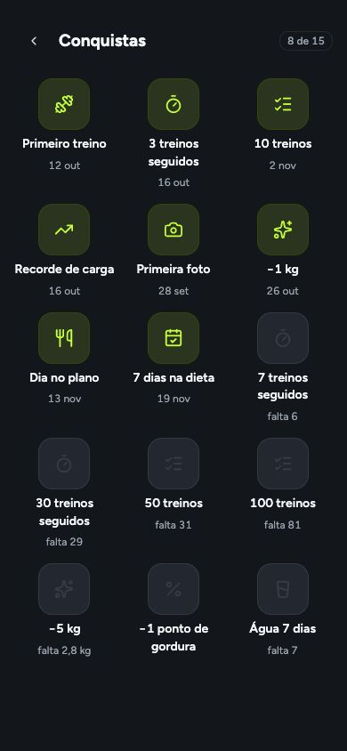 |

- **Registrar a semana.** Em **Registrar**, anote peso e medidas ou adicione fotos de frente, lado e costas. Cada campo de medida mostra o último valor anterior com a data, quando houver. No dia do check-in, **Atualizar** reúne os registros da semana.
- **Consultar o histórico.** O calendário mostra os registros de cada dia. Abra uma foto e deslize entre os ângulos do registro. Use **Comparar fotos** para colocar duas datas lado a lado.
- **Compartilhar.** Gere o PDF de evolução para enviar um resumo do período. O primeiro carregamento do gerador pode precisar de internet.

## Dieta

O cardápio organiza as refeições por horário. Abra uma delas para escolher a opção, ajustar porções ou incluir um extra. **Comi esta** registra a refeição e atualiza o total do dia. A mesma aba reúne água e suplementos.

| Cardápio de hoje | Refeição | Lista de compras |
| :---: | :---: | :---: |
| 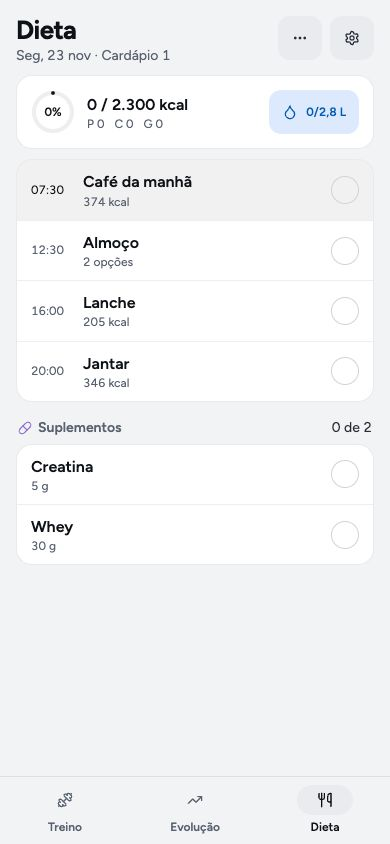 | 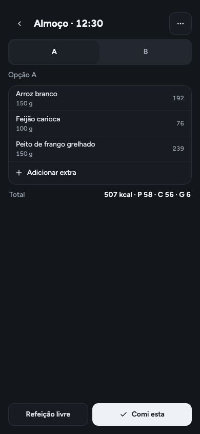 | 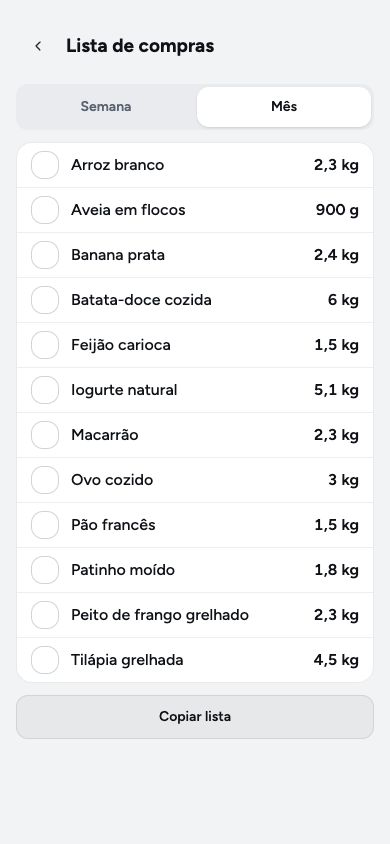 |

- **Planejar.** Em **Configurações → Cardápio**, edite metas, refeições e alternativas. A busca usa a tabela TACO e aceita alimentos cadastrados por você.
- **Adaptar.** Em **Mais opções da dieta**, troque o cardápio do dia, marque um dia livre ou abra a lista de compras. Dá para marcar itens comprados e copiar os que faltam.
- **Personalizar.** Em Configurações, ajuste a meta de água, o volume do copo e os suplementos que quer acompanhar.

## Configurações, aparência e backup

Em **Configurações → App**, escolha **Escuro**, **Claro** ou **Sistema** para seguir a aparência do aparelho. **Novidades** mostra o que mudou na versão. **Atualizar app** busca a versão disponível e recarrega o Pump.

| Editar plano | Perfil | Aparência e atualização |
| :---: | :---: | :---: |
| 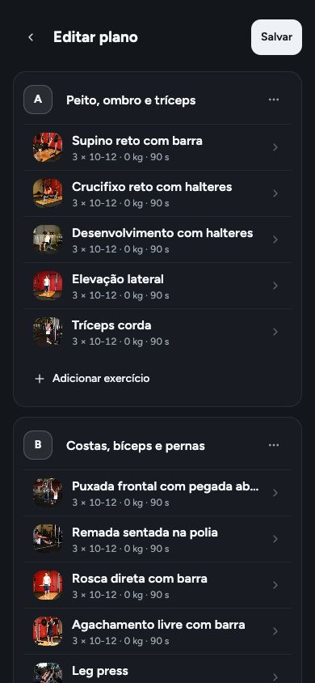 | 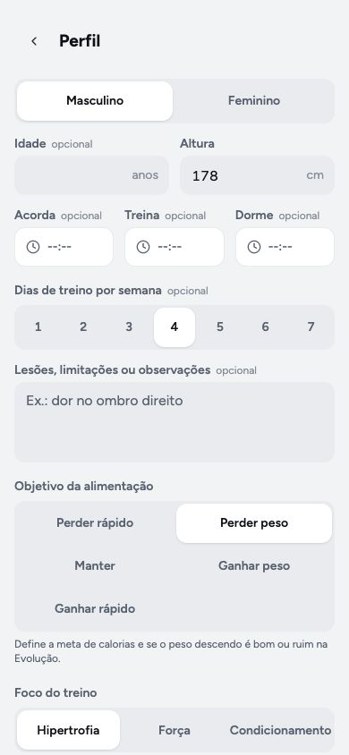 | 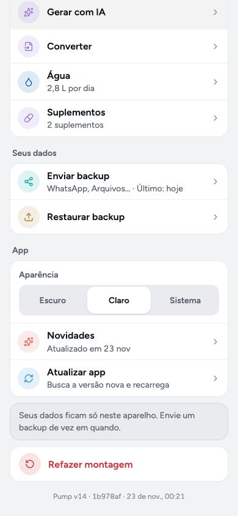 |

Os registros ficam em IndexedDB, no navegador ou no app instalado. Antes de trocar de aparelho ou limpar os dados do site, use **Enviar backup** e guarde o JSON. No destino, **Restaurar backup** recupera o histórico e as fotos e substitui os dados que já estavam ali. Para rever o passo a passo inicial no mesmo aparelho, use **Refazer montagem**.

## Importar treino ou dieta

1. Abra o grupo **Treino** ou **Dieta** em Configurações. Use **Gerar com IA** para começar pelos seus objetivos, **Converter** para aproveitar uma ficha existente ou **Ajustar com IA** para mudar um plano salvo.
2. Copie o prompt para a sua ferramenta de IA. Na conversão, envie também a ficha em texto, imagem ou PDF. Se a ferramenta não conseguir abrir o catálogo, use **Copiar a lista**.
3. Cole a resposta no Pump ou selecione o JSON. Revise antes de salvar. Se o catálogo de exercícios estiver indisponível, você pode seguir sem as prévias ou tentar carregá-lo outra vez.

## Rodar localmente

Instale o [Bun](https://bun.sh/) e execute os comandos abaixo.

```sh
git clone https://github.com/yagoramires/pump.git
cd pump
bun install --frozen-lockfile
bun run dev
```

Abra [localhost:5173/pump/](http://localhost:5173/pump/).

| Comando | O que faz |
| --- | --- |
| `bun run test` | Executa os testes com Vitest. |
| `bun run lint` | Verifica o código com Oxlint. |
| `bun run build` | Valida os tipos e gera o site estático em `dist/`. |
| `bun run preview` | Serve o build localmente para conferência. |

O Pump usa React, TypeScript, Vite, Tailwind CSS, IndexedDB e service worker. As imagens de exercícios vêm do [Free Exercise DB](https://github.com/yuhonas/free-exercise-db). O catálogo nutricional usa a Tabela Brasileira de Composição de Alimentos (TACO).

O catálogo e as imagens de exercícios podem precisar de conexão. O alerta sonoro do descanso funciona em primeiro plano e pode ser silenciado pelo iPhone. A estimativa de gordura corporal depende das medidas preenchidas e serve para acompanhar tendências.
