<div align="center">
  
  <h1>Pump</h1>
  <p><strong>Treino, dieta e evolução no mesmo app.</strong></p>
  <p>Registre séries, organize refeições e acompanhe seus resultados no seu ritmo.</p>
  <p><a href="https://yagoramires.github.io/pump/"><strong>Abrir o Pump</strong></a> · <a href="#como-usar">Como usar</a> · <a href="#rodar-localmente">Rodar localmente</a></p>
  
</div>

> As capturas usam fichas, refeições, medições e imagens de progresso fictícias.

## Como usar

1. **Abra o app.** No iPhone, abra pelo Safari e use **Compartilhar → Adicionar à Tela de Início**.
2. **Configure seu perfil.** Preencha seus dados e objetivos. No **Dia zero**, registre seu peso e, se quiser, medidas e fotos para ter uma referência inicial.
3. **Monte a rotina.** Escolha um treino pronto, monte do zero ou importe uma ficha. Para a dieta, crie um cardápio ou importe um que você já usa. Dá para pular a configuração de treino ou dieta e voltar depois.
4. **Registre o dia.** Use as abas **Treino** e **Dieta** para acompanhar o que fez. Abra **Evolução** para consultar o histórico e comparar os registros.

<details>
<summary>Ver as cinco etapas da montagem inicial</summary>

| Sobre você | Objetivos | Dia zero |
| :---: | :---: | :---: |
| 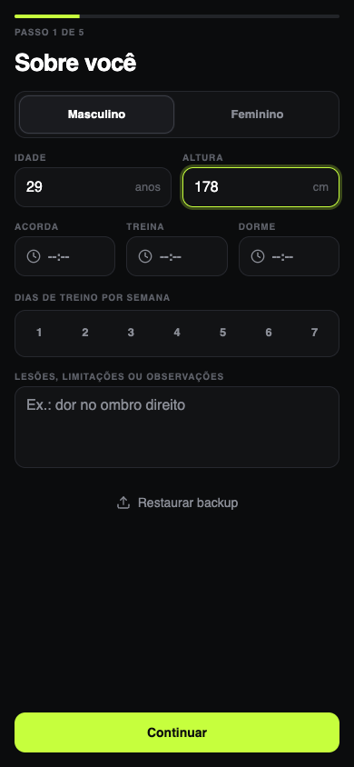 | 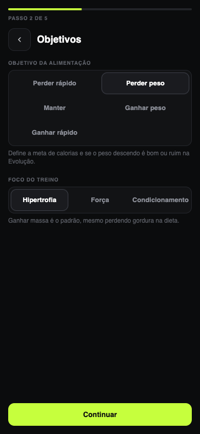 | 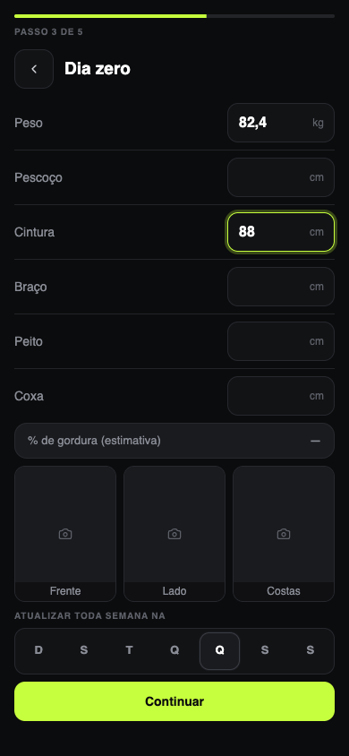 |

| Seu treino | Sua dieta |
| :---: | :---: |
| 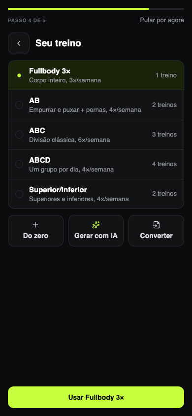 | 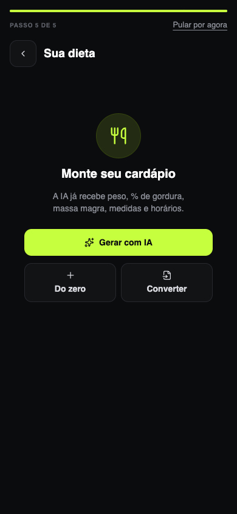 |

</details>

## Treino

Abra a ficha do dia, ajuste a carga e as repetições da série e marque quando terminar. Se a ficha traz uma sequência como **12-10-8** em três séries, o app preenche cada linha com o valor correspondente. Quando a série tem descanso programado, o cronômetro abre automaticamente. Você pode pausar, acrescentar 15 segundos ou pular o intervalo.

| Ficha e séries | Contador de descanso | Prévia do exercício |
| :---: | :---: | :---: |
| 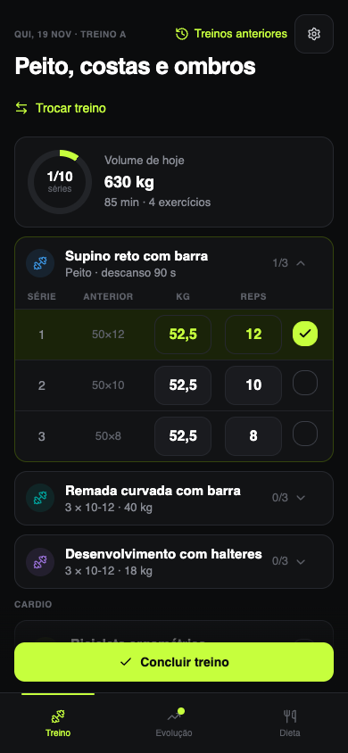 | 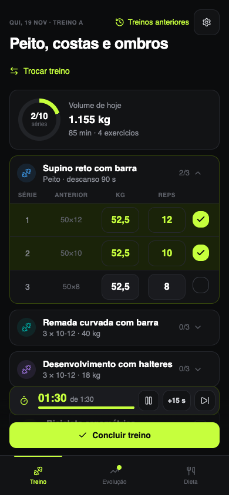 | 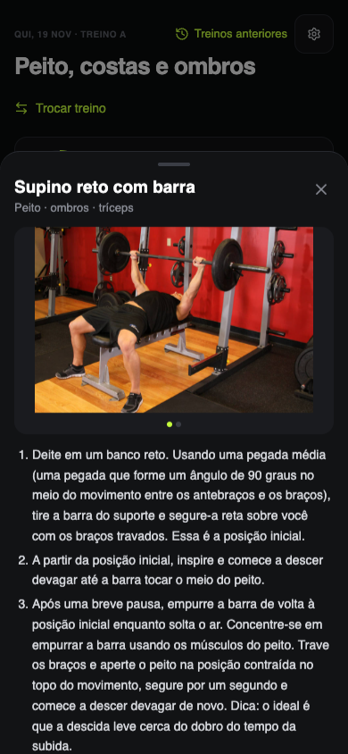 |

- **Montar e editar.** Abra **Configurações → Editar plano**. Adicione exercícios do catálogo ou crie os seus. Toque na miniatura para ver imagens e instruções. O nome e a seta abrem a edição de séries, repetições, carga e descanso.
- **Escolher a sessão.** O Pump sugere a próxima ficha conforme a ordem do plano e o último treino concluído. Use **Trocar treino** para escolher outra ou **Marcar descanso** quando for dia de pausa.
- **Consultar cargas anteriores.** A tabela da sessão mostra os valores da última vez que o exercício foi registrado. **Treinos anteriores** abre as sessões concluídas e seus detalhes.

<details>
<summary>Ver edição, catálogo, troca de ficha e treinos anteriores</summary>

| Plano | Ajustes do exercício | Catálogo |
| :---: | :---: | :---: |
| 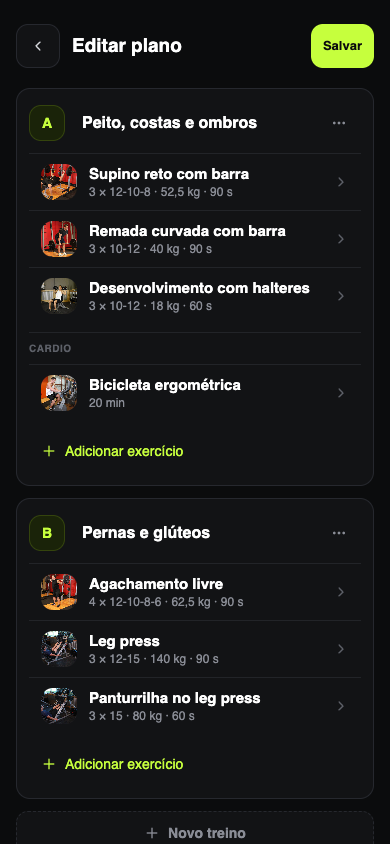 | 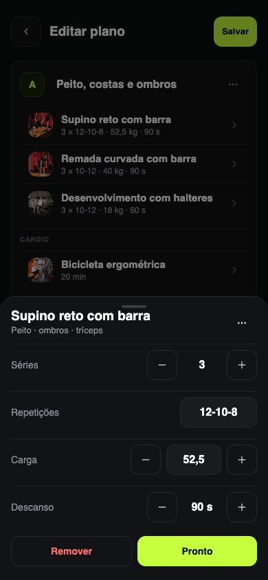 | 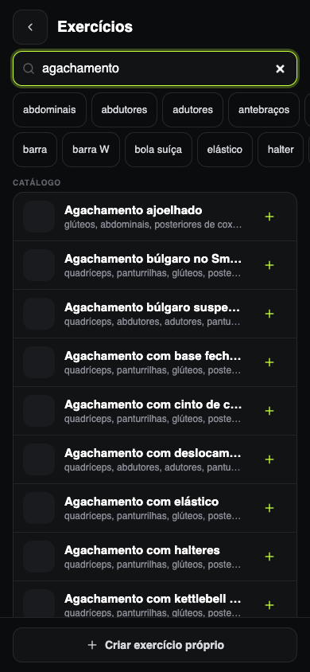 |

| Trocar treino | Treinos anteriores |
| :---: | :---: |
| 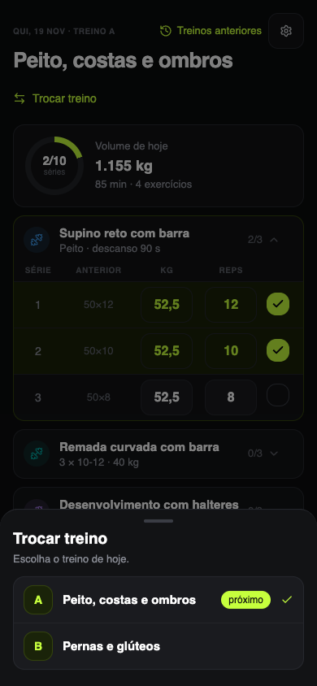 | 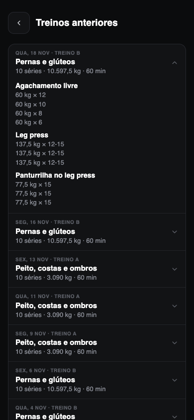 |

</details>

## Dieta

O cardápio organiza as refeições do dia por horário. Abra uma refeição para escolher uma opção, ajustar porções, trocar alimentos ou adicionar extras. Marque **Comi esta** para registrar e veja calorias e macros na aba principal. Use o contador de água para registrar copos ao longo do dia.

| Resumo diário | Refeição e opções | Água |
| :---: | :---: | :---: |
| 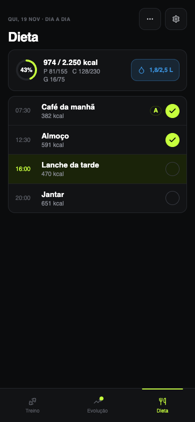 | 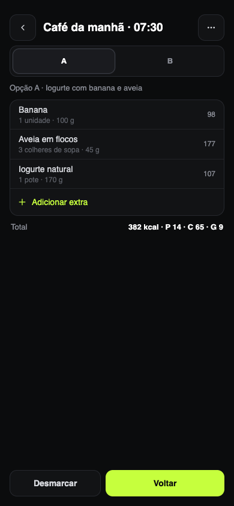 | 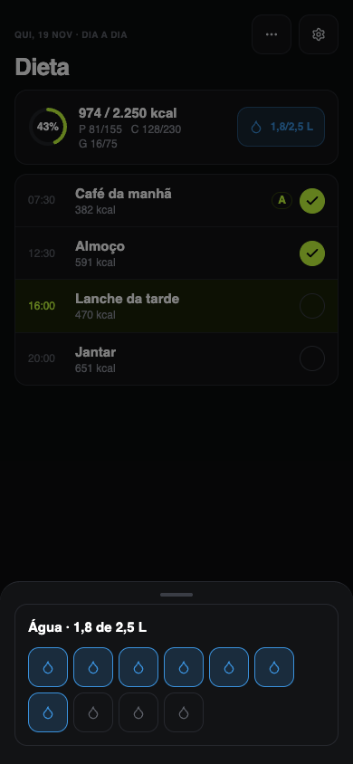 |

- **Planejar.** Em **Configurações → Cardápio**, edite metas, refeições e alternativas. A busca de alimentos usa a tabela TACO e permite cadastrar itens próprios.
- **Adaptar o dia.** Em **Mais opções da dieta**, mude o cardápio do dia, marque **Dia livre** ou abra a lista de compras. Uma única refeição também pode ser marcada como livre.
- **Comprar.** A lista estima quantidades para uma semana ou um mês com base nos cardápios. Marque o que já comprou e copie o que falta.
- **Personalizar a água.** Em **Configurações → Água**, ajuste a meta diária, o tamanho do copo e a exibição do contador.

<details>
<summary>Ver cardápios, busca de alimentos e lista de compras</summary>

| Editor de cardápio | Busca de alimentos | Compras |
| :---: | :---: | :---: |
| 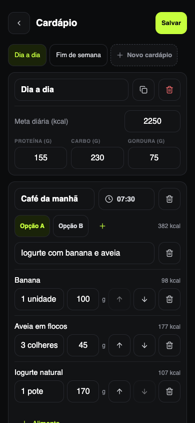 | 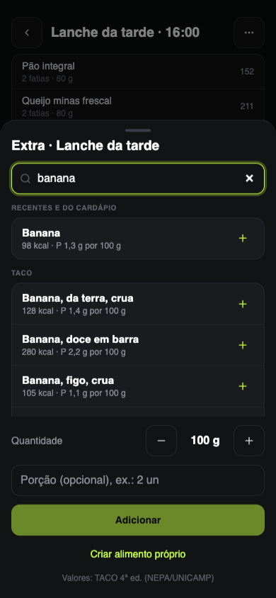 | 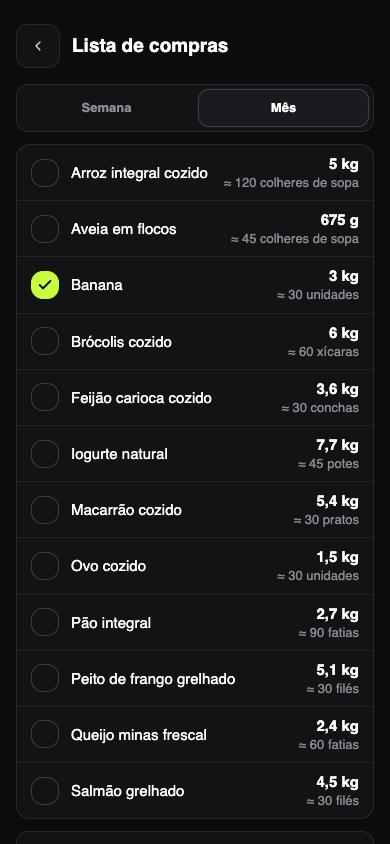 |

| Escolher o cardápio de hoje | Configurar água |
| :---: | :---: |
| 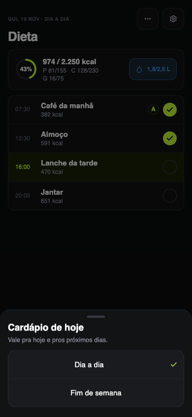 | 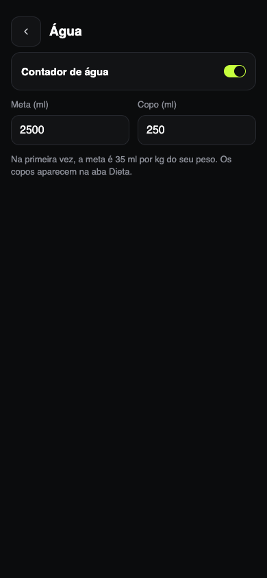 |

</details>

## Evolução

Veja peso, medidas, estimativa de gordura corporal e frequência de treinos. O gráfico de peso pode mostrar 7, 30 ou 90 dias, ou todo o histórico. A aba também reúne a consistência da dieta, a hidratação e as conquistas.

| Painel e gráfico | Comparar fotos | Histórico |
| :---: | :---: | :---: |
| 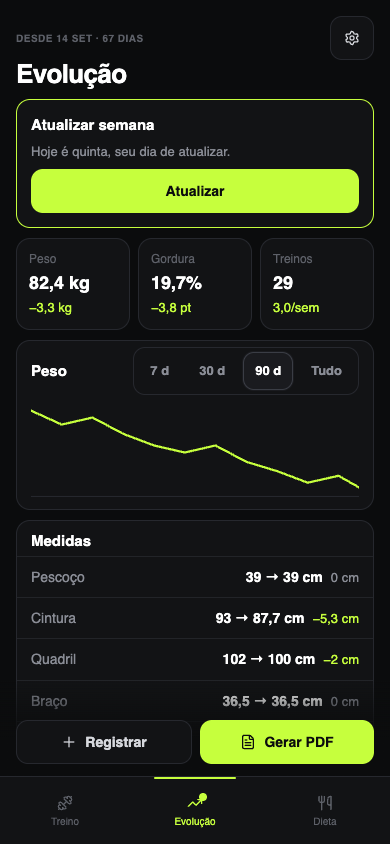 | 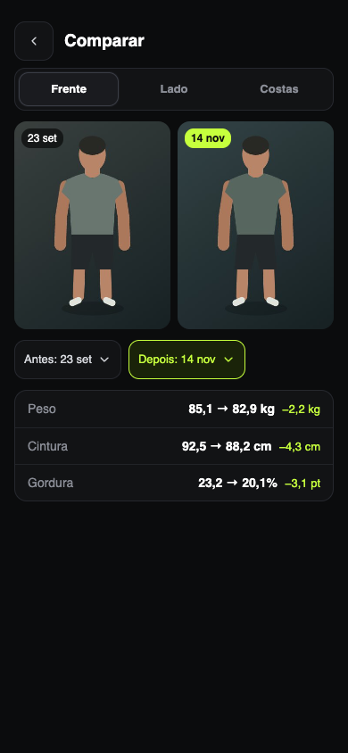 | 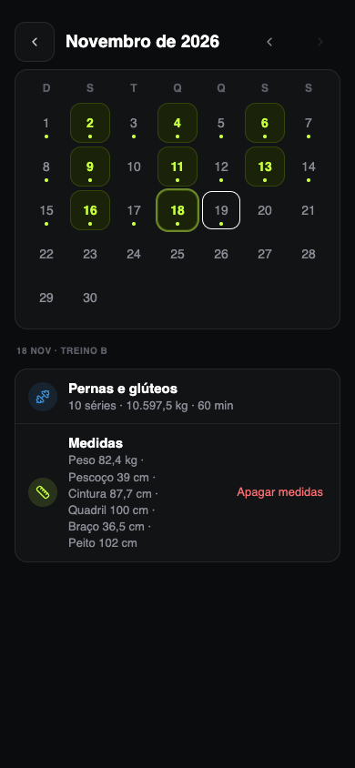 |

- **Registrar.** Toque em **Registrar** para anotar peso e medidas ou adicionar imagens da câmera ou da galeria. As imagens podem ser separadas por frente, lado e costas.
- **Fazer o check-in.** No dia configurado, use **Atualizar** para registrar a semana e ver as mudanças desde os registros anteriores.
- **Comparar e consultar.** Escolha duas datas em **Comparar**, veja os dias com registros em **Histórico** e abra **Conquistas** para consultar os marcos.
- **Compartilhar.** Use **Gerar PDF** e depois **Compartilhar PDF** para exportar um resumo do período. A primeira geração pode precisar de internet para carregar o gerador.

<details>
<summary>Ver registro, captura de fotos, check-in, conquistas e relatório</summary>

| Registrar medidas | Capturar fotos | Check-in semanal |
| :---: | :---: | :---: |
| 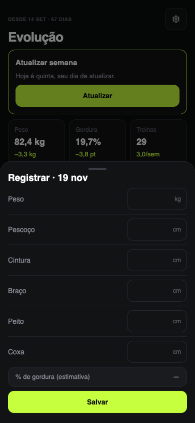 | 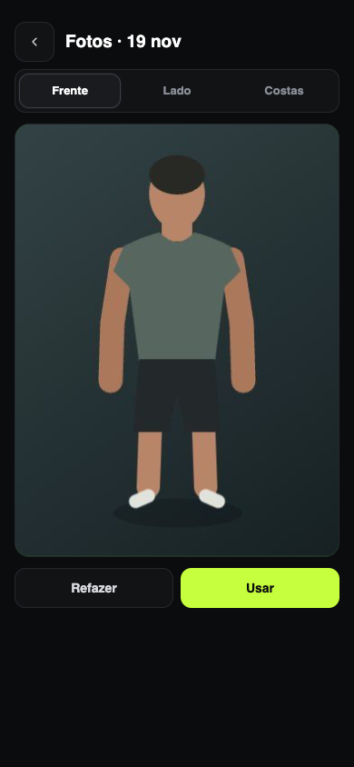 | 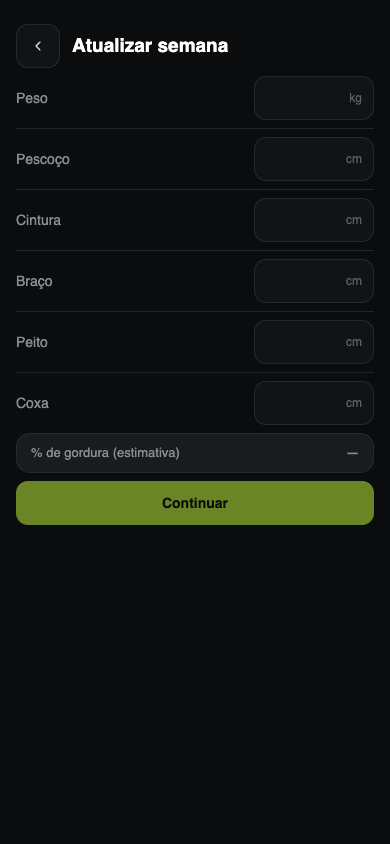 |

| Resumo da semana | Conquistas | PDF |
| :---: | :---: | :---: |
| 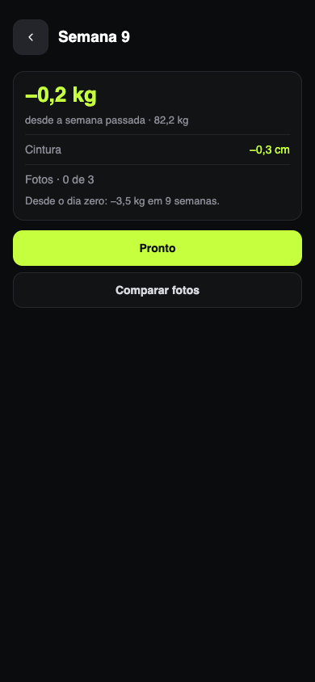 | 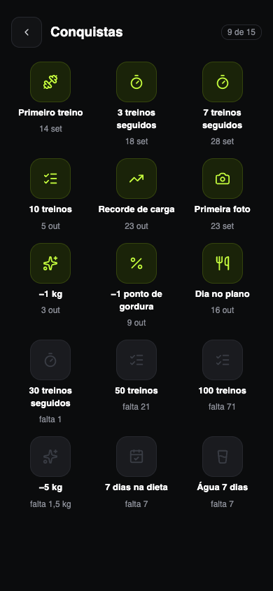 | 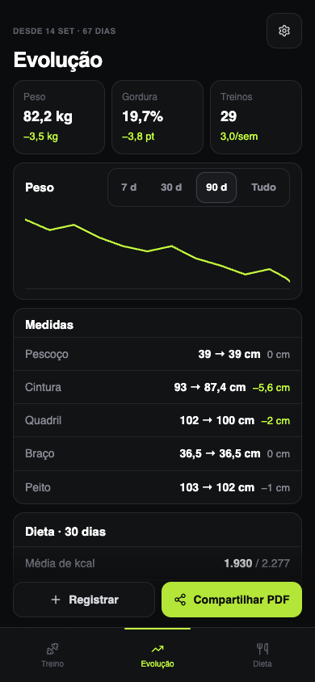 |

</details>

## Importar treino ou dieta

No grupo **Treino** ou **Dieta** das configurações, escolha **Gerar com IA** para montar um plano a partir dos seus objetivos. Se você já tem uma ficha em texto, imagem ou PDF, use **Converter** e envie a ficha junto com o prompt na sua ferramenta de IA.

1. Copie o prompt que o Pump prepara. Quando a ferramenta não conseguir abrir a lista do catálogo, use **Copiar a lista** e cole também.
2. Cole a resposta no Pump ou selecione o arquivo JSON. O app aceita o texto da resposta junto com o bloco de código.
3. Revise o resultado antes de salvar. Se o catálogo de exercícios estiver indisponível, dá para seguir sem prévias ou tentar carregá-lo outra vez mantendo a resposta colada.

<details>
<summary>Ver as telas de geração e conversão</summary>

| Gerar treino | Converter ficha |
| :---: | :---: |
| 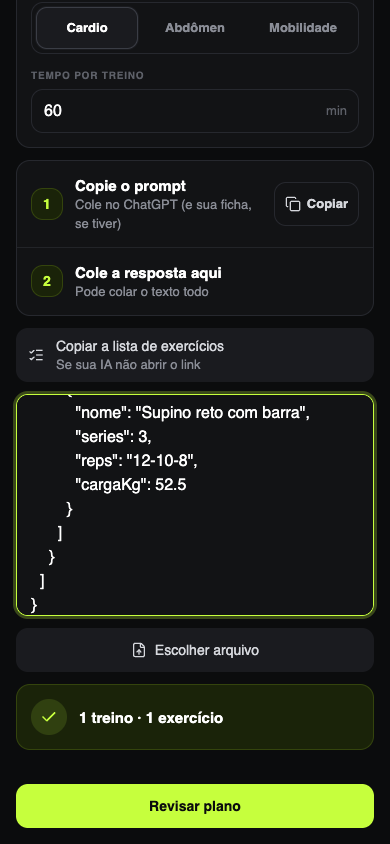 | 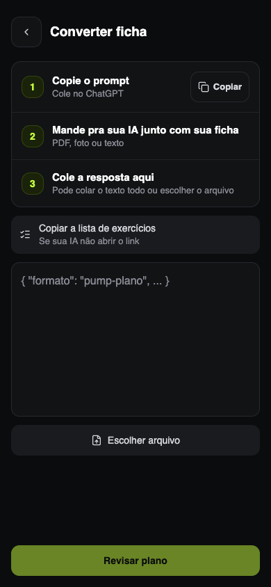 |

| Gerar dieta | Converter cardápio |
| :---: | :---: |
| 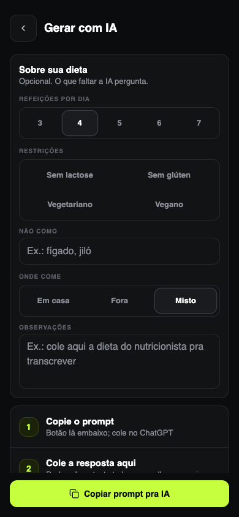 | 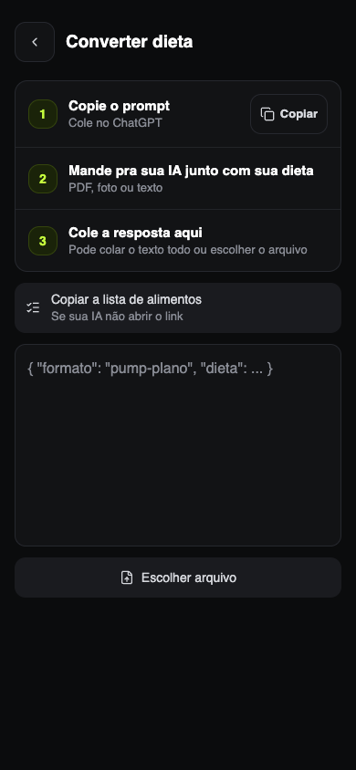 |

</details>

## Configurações, dados e backup

Os dados ficam no navegador ou no app instalado, em IndexedDB. O Pump dispensa conta e servidor para armazenar seu histórico. O catálogo, as imagens de exercício e a primeira geração do PDF podem precisar de conexão.

- **Perfil.** Em **Configurações → Perfil**, atualize dados, horários, objetivos e o dia do check-in.
- **Guardar uma cópia.** Use **Enviar backup** e salve o JSON em Arquivos ou em outro local seguro. O backup inclui o histórico e as fotos registradas.
- **Mudar de navegador ou aparelho.** Exporte o backup na origem e use **Restaurar backup** no destino, na montagem inicial ou em Configurações. A restauração substitui os dados do destino.
- **Refazer a montagem.** A opção reabre as etapas iniciais com os registros ainda salvos.

| Configurações | Perfil | Restaurar backup |
| :---: | :---: | :---: |
| 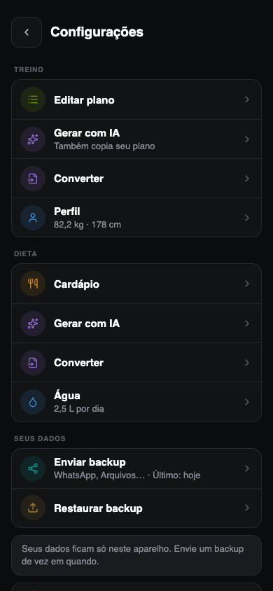 | 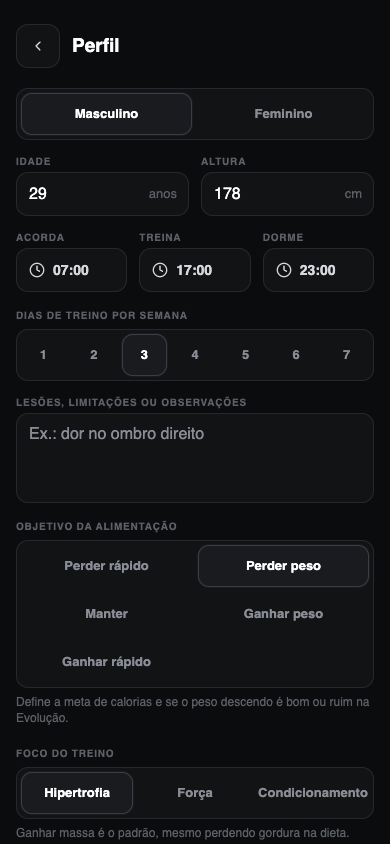 | 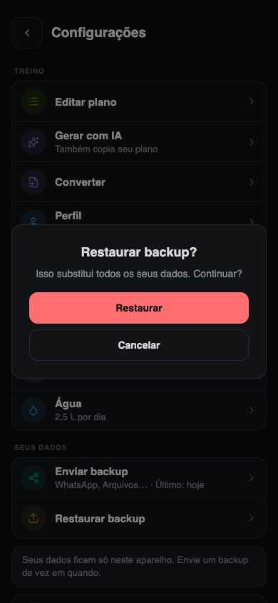 |

## Rodar localmente

Com [Bun](https://bun.sh/) instalado:

```sh
git clone https://github.com/yagoramires/pump.git
cd pump
bun install --frozen-lockfile
bun run dev
```

Abra [http://localhost:5173/pump/](http://localhost:5173/pump/).

| Comando | O que faz |
| --- | --- |
| `bun run test` | Executa os testes com Vitest. |
| `bun run lint` | Verifica o código com Oxlint. |
| `bun run build` | Valida os tipos e gera o site estático em `dist/`. |
| `bun run preview` | Serve o build localmente para conferência. |

O Pump usa React, TypeScript, Vite, Tailwind CSS, IndexedDB e service worker. As imagens de exercícios vêm do [Free Exercise DB](https://github.com/yuhonas/free-exercise-db) e o catálogo nutricional usa a Tabela Brasileira de Composição de Alimentos (TACO).

### Limites conhecidos

- O alerta sonoro de descanso funciona com o app em primeiro plano. O modo silencioso pode impedir o som no iPhone.
- A estimativa de gordura corporal depende das medidas preenchidas e serve para acompanhar tendências.
- O armazenamento é local. Limpar os dados do site ou reinstalar pode apagar os registros daquele navegador. Exporte um backup antes de migrar.
